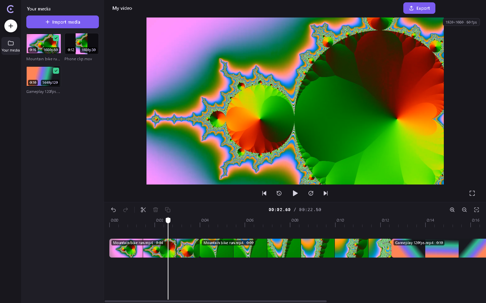
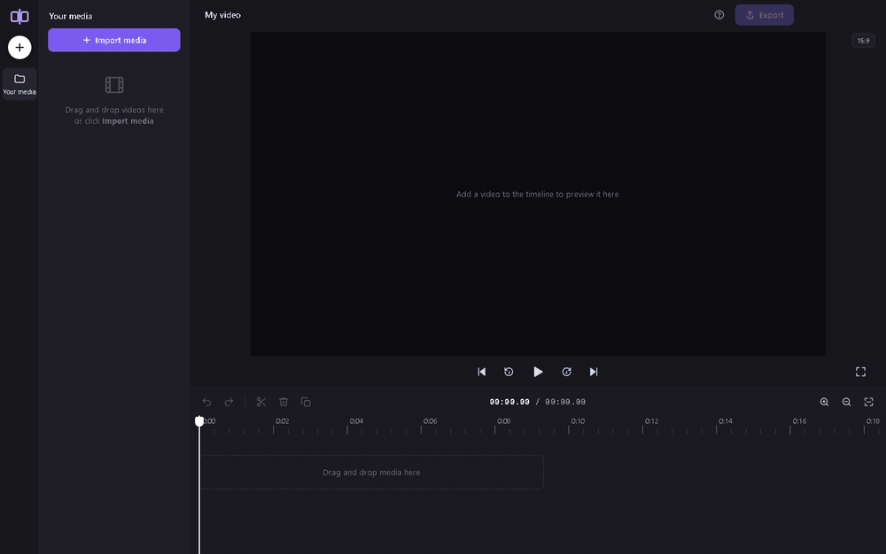

<p align="center"></p>

<h1 align="center">ClipCut</h1>

<p align="center"><b>A Clipchamp-style video cutter for Windows that leaves your footage's resolution, frame rate and orientation exactly as it found them.</b></p>

<p align="center">Designed by Adam Reep; built by directing Claude.</p>

Open a long recording (or several), cut out the parts you don't want, join what's left, export. 120 fps stays 120 fps, 4K stays 4K, portrait phone video stays portrait. Everything runs on your own PC: no account, no cloud, no cache quietly filling up your drive.





## Why I built it

I trim a lot of long recordings down to the good parts, and Clipchamp's layout is exactly as simple as I want: media on the left, preview in the middle, timeline underneath, split and delete. Three things kept getting in the way:

- **Exports top out at 30 fps.** My 60 and 120 fps footage came out blurred.
- It kept trying to put every project in OneDrive.
- Its cache had quietly taken 35 GB of my drive.

LosslessCut can do this job, but its interface never clicked for me, and the free desktop editors all come with a learning curve. So I had the part of Clipchamp I actually use rebuilt around one rule: **the export is the original video, 1:1, with only the deleted parts removed.**

The idea, the interface brief and the testing are mine; the code was written by Anthropic's Claude (through Claude Code) working to that brief.

## Features

- **Clipchamp-style editing.** Media panel, preview with transport controls, one magnetic timeline. Drag videos in, split with **S**, delete, trim the edges, drag to reorder, undo/redo.
- **Native output.** Resolution, frame rate (including 60/120 fps and 23.976/29.97), rotation, and 10-bit HEVC / HDR colour metadata are read from the source and kept.
- **Frame-exact cuts.** The frame under the playhead is the frame the cut lands on; **←/→** step one frame at a time.
- **Join several videos** into one file. Clips with a different size or frame rate are fitted to the first clip.
- **Two export modes.** *Exact cuts* re-encodes at near-original quality on your GPU (NVIDIA NVENC, Intel Quick Sync or AMD AMF, detected automatically, CPU fallback). *Fast & lossless* copies the original video data without re-encoding and finishes in seconds.
- **GPU picker.** On a PC with more than one card, you choose which one does the encoding.
- **Private and tidy.** Nothing leaves your PC. Thumbnails live in memory, and temporary files are deleted the moment an export finishes.
- Reads whatever ffmpeg reads: MP4, MOV, MKV, WebM, AVI, MTS and more.

## Install

Windows 10/11, 64-bit. A GPU is optional.

1. **Get the code.** Click the green **Code** button → **Download ZIP** and unzip it somewhere permanent, or `git clone https://github.com/reepadam/clipcut.git`.
2. **Double-click `Setup.bat`.** It downloads what the app needs *into the ClipCut folder* (nothing is installed system-wide): ffmpeg 9.0.2 from gyan.dev (about 110 MB), Electron through npm (about 100 MB) and, only if you don't already have Node.js 22.12 or newer, a portable Node.js 26 (about 40 MB). The ffmpeg and Node.js downloads are pinned to those exact versions and checked against their published SHA-256 before anything is unpacked. It takes a minute or two and finishes by putting a **ClipCut** shortcut on your desktop.
   SmartScreen may say "Windows protected your PC" because the script isn't signed: choose **More info → Run anyway**.
3. **Double-click the ClipCut shortcut.**

To update later, download the new version over the old folder (or `git pull`) and run `Setup.bat` again; it only fetches what's missing.

## Using it

1. **Import** videos with **Import media**, or drag files from File Explorer onto the window.
2. **Add to the timeline.** Drag a video from the left panel onto the timeline, click its **+**, or double-click it. Add several videos to join them, and drag clips on the timeline to reorder them.
3. **Cut out the parts you don't want.**
   - Put the playhead where the unwanted part starts and press **S**.
   - Put it where the part ends and press **S** again.
   - Click the middle piece and press **Delete**. The gap closes by itself.
   - Or drag the white edges of a clip to trim its start or end.
4. **Export.** Pick a name and a location.
   - **Exact cuts** (default): frame-accurate, re-encoded at near-original quality. Pick the quality level (*High* is a good default; *Visually lossless* makes a bigger file) and the video card, or the CPU; ClipCut remembers the card you chose.
   - **Fast & lossless**: no re-encoding at all, done in seconds. Each cut starts at the nearest earlier keyframe, so it can begin up to a couple of seconds early. Only offered when every clip comes from a video with the same format.
   - The file type follows the name you choose: `.mp4` (default), `.mov` or `.mkv`.

### Keyboard shortcuts

| Key | Action |
| --- | --- |
| Space | Play / pause (clicking the preview does the same) |
| S | Split at the playhead |
| Delete or Backspace | Delete the selected clip |
| ← / → | Step one frame |
| Shift + ← / → | Jump one second |
| Home / End | Go to the start / end |
| Ctrl+Z / Ctrl+Y | Undo / redo |
| Ctrl+D | Duplicate the selected clip |
| Ctrl + mouse wheel, Ctrl + / Ctrl − | Zoom the timeline |
| Ctrl+0 | Fit the whole timeline in the window |
| Ctrl+I | Import media |
| Ctrl+E | Export |
| Esc | Deselect |

### Good to know

- When you join videos with different sizes or frame rates, the export matches the **first** clip on the timeline. The others are scaled to fit, with black bars where the shape differs.
- 10-bit and HDR sources are exported as 10-bit HEVC with their colour tags (primaries, transfer, matrix) and HDR10 mastering-display / content-light metadata intact, on both the CPU and NVENC paths; nothing is tone-mapped.
- The preview uses Chromium's video decoders. A format it can't play (ProRes, for example) shows "No preview" but still cuts and exports normally.
- Press **?** in the app for the shortcut list. The only thing ClipCut stores between sessions is a few kilobytes of settings (your video-card choice) in `%AppData%\ClipCut`.
- Keep the ClipCut folder out of OneDrive or other synced folders: `node_modules` and `tools` are hundreds of megabytes of files that a sync client will happily upload and occasionally lock.

## How it works

- An [Electron](https://www.electronjs.org/) app in plain HTML, CSS and JavaScript, no framework. The preview uses two `<video>` elements and swaps between them at cut points, so playback doesn't stutter across a cut.
- `ffprobe` reads each file's real frame rate (variable-rate phone footage is snapped to the nearest standard rate), rotation, pixel format and colour metadata.
- **Exact cuts:** each segment is seeked to half a frame before its first frame and trimmed to half a frame before its last, then the segments go through ffmpeg's `concat` filter with an `fps` filter pinned to the native rate, so the output has exactly the frames you saw. The encoder is `h264_nvenc` / `hevc_nvenc`, `_qsv`, `_amf`, or `libx264` / `libx265` on the CPU.
- **Fast & lossless:** `-ss … -t … -c copy` per segment, joined with the `concat` demuxer. No decoding at all.
- Hardware encoders are detected at startup by attempting a tiny encode with each one, so the picker only ever lists cards that really work on that PC.

## Development

```
git clone https://github.com/reepadam/clipcut.git
cd clipcut
Setup.bat        # or `npm install`, in which case ffmpeg 6+ (a full build with libx264/libx265) must be on your PATH or in tools\ffmpeg
npm start
npm test
```

| Path | What it is |
| --- | --- |
| `src/main.js` | Electron main process: window, dialogs, IPC |
| `src/preload.js` | The small API the page is allowed to call |
| `src/ffmpeg.js` | Probing, hardware-encoder detection, the export engine |
| `src/renderer/` | The editor page: `app.js`, `styles.css`, `index.html`, icons |
| `scripts/setup.ps1` | What `Setup.bat` runs |
| `test/run.js` | `npm test`: generates test footage, drives the real app through an edit and every export path, verifies the output with ffprobe |

`npm test` takes about a minute. It checks that imported files are read correctly, that split + delete removes exactly the chosen frames, that every export has the right size, frame rate, codec and an exact frame count, and that cancelling an export leaves no partial file behind. Hardware encoders are tested only if the machine has them.

The app can be driven from a script: set `CLIPCUT_TEST` to a module exporting `(win, ctl) => {}` and `src/main.js` calls it with the window once it's open. `test/ui.js` is an example.

## Credits and licenses

- ClipCut is released under the [MIT License](LICENSE), © 2026 Adam Reep.
- **FFmpeg** is not part of this repository. `Setup.bat` downloads the ["essentials" build from gyan.dev](https://www.gyan.dev/ffmpeg/builds/), which is licensed under the **GPL** because it includes libx264 and libx265. ClipCut runs it as a separate program. See [ffmpeg.org/legal](https://ffmpeg.org/legal.html).
- [Electron](https://www.electronjs.org/) is MIT-licensed and downloaded through npm.
- Clipchamp is a Microsoft product. ClipCut is an independent project that borrows its layout and nothing else.
- Designed by Adam Reep; built by directing Claude.
